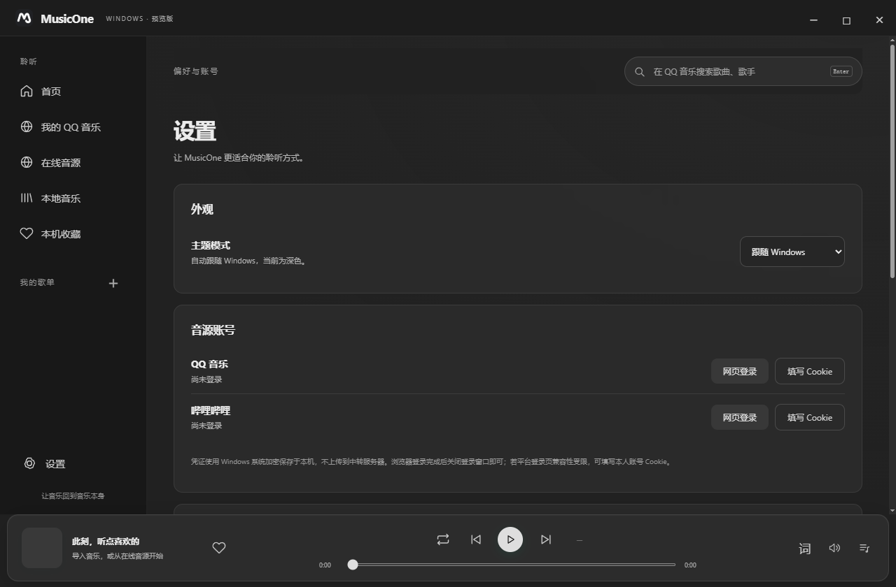
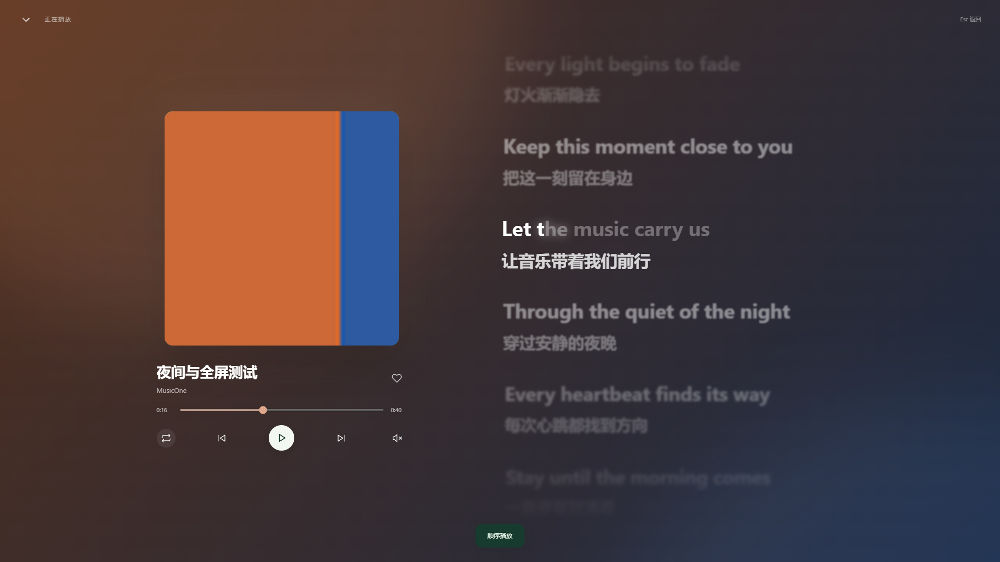

# MusicOne Windows

**让音乐回到音乐本身。**

MusicOne Windows 是一款面向 Windows 10 / 11 的开源音乐播放器。它把本地音乐、QQ 音乐个人歌单与沉浸式歌词放在一个简洁的桌面界面中，支持跟随系统的深色模式、专辑封面动态取色，以及平滑的全屏播放过渡。

基于 [HGODLK/MusicOne](https://github.com/HGODLK/MusicOne) 独立适配，采用 **MIT 许可**。本项目为社区 Windows 版本，非原作者官方发行版。

## 下载与安装

前往 [Releases 下载 1.0.0](https://github.com/2384099243/MusicOne-Windows/releases/tag/v1.0.0)。

- **安装版**：`MusicOne-Windows-1.0.0-Setup-x64.exe`，提供安装向导、开始菜单入口、可选桌面快捷方式和卸载入口。默认仅为当前用户安装，无需管理员权限。
- **便携版**：`MusicOne-Windows-1.0.0-x64.zip`，完整解压后运行 `MusicOne.exe`，请保留同目录全部运行文件。
- **源码**：可直接克隆本仓库，或下载 `MusicOne-Windows-1.0.0-source.zip`。

支持 Windows 10 / 11 x64，已在 Windows 10 22H2 验证。升级前先退出正在运行的旧版。安装版和便携版共用 `%APPDATA%\MusicOne Windows\` 中的登录与歌单数据，卸载程序不删除该用户数据目录。安装包当前未作数字签名。

## 功能

- **本地音乐**：导入音乐或扫描文件夹，支持 MP3、FLAC、WAV、M4A 等常见格式；本机收藏、自建歌单、播放队列、进度与音量控制。
- **QQ 音乐库**：登录后读取“我喜欢”、自建与收藏歌单，点击直接播放，无需逐个导入；左侧“我的歌单”可直接打开 QQ 自建歌单。
- **在线播放**：QQ 音乐搜索与账号音源，按所选音质向下降级；音频验证、备用地址和有限重试。支持哔哩哔哩 BV 音频及账号收藏夹。
- **沉浸歌词**：真正全屏的播放布局，封面与控件平滑过渡；弹性滚动、动态模糊、双语歌词。存在真实逐字时间时启用逐字填充与高亮。
- **视觉与主题**：跟随 Windows 的浅色 / 深色主题，灰黑磨砂界面、专辑封面动态取色，以及系统减少动态效果适配。
- **本机保存**：登录凭证通过 Windows 加密保存；可导出不含凭证的播放诊断，方便定位播放失败。

## 界面预览

预览使用测试封面和原创歌词，不包含用户账号内容。




## 使用

1. 本地音乐：选择“本地音乐”后添加音乐或导入文件夹。同名 UTF-8 LRC 可自动读取。
2. QQ 音乐：打开“我的 QQ 音乐”登录，歌单读取后可直接打开；“刷新音乐库”更新列表及侧栏。
3. 歌词：点击底部封面或“词”进入全屏。左上角返回或 Esc 退出；音量按钮点击后展开滑条。
4. 主题：设置 → 外观，可选择跟随 Windows、浅色或深色。

更多说明见 [使用指南](docs/使用指南.md)、[更新说明](更新说明.md) 与 [验证记录](验证记录.md)。

## 目前的边界

在线播放取决于平台接口、地区、登录状态与账号权益，自动音质降级不改变账号权限。会员内容仅在平台为当前账号提供音源时可用。

QQ 加密 QRC 解密、网易云与酷狗、原版个性化推荐、云端收藏双向写入、USB 独占输出、APE / DSD 专用解码尚未适配。普通 LRC 显示逐行进度，不生成虚构的逐字时间。

## 开发与构建

使用 Node.js 安装固定版本的 Electron：

```sh
npm install
npm start
npm test
```

使用 Python 3 标准库构建 Windows x64 便携包，脚本下载 Electron 官方运行组件并验证 SHA-256：

```sh
python build_windows.py
```

输出目录为 `dist/MusicOne-Windows`。安装 [Inno Setup 6.7.3](https://jrsoftware.org/isdl.php) 后，可在本目录构建安装程序：

```sh
ISCC.exe installer.iss
```

安装脚本默认从 `dist/MusicOne-Windows` 取文件，将安装包写到 `dist/`。也可传入 `/DAppSource=完整便携目录` 和 `/DOutputPath=输出目录`。更新版本时请同步 `package.json`、应用关于信息及 `installer.iss`。

## 反馈与贡献

欢迎通过 [Issues](https://github.com/2384099243/MusicOne-Windows/issues) 提交问题，通过 Pull Request 贡献改进。反馈播放问题时请提供系统版本、软件版本、复现步骤及已脱敏的诊断；请勿上传 Cookie 或账号凭证。

## 开源与致谢

源码采用 [MIT 许可](LICENSE)，原项目版权和许可保留在 [LICENSE-MusicOne](LICENSE-MusicOne)。感谢原作者 ShuyunR / HGODLK；音源协议逻辑与图标来源于原项目，Windows 界面与播放层独立适配。

Electron 等运行组件分别适用其自身许可，详细来源见 [NOTICE](NOTICE.md)。本项目不附带音乐文件；在线内容及商标权利归各自权利人所有。
